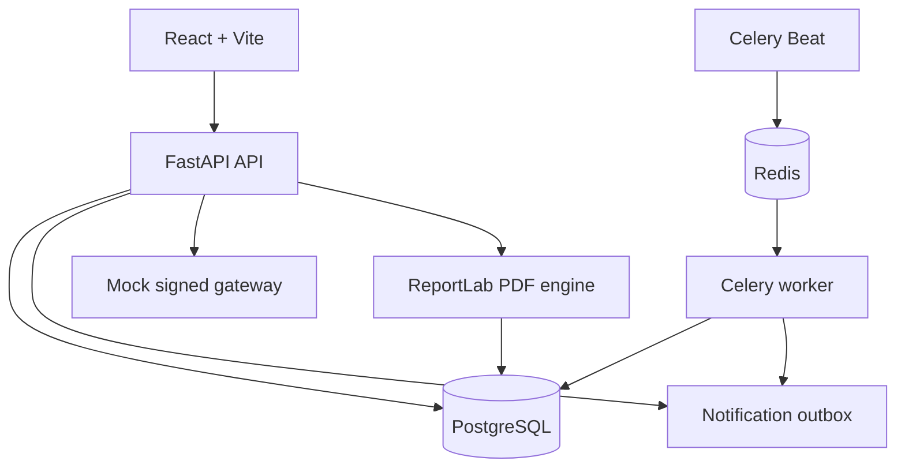
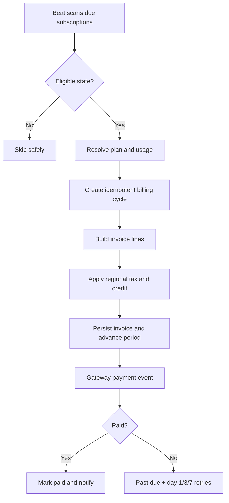
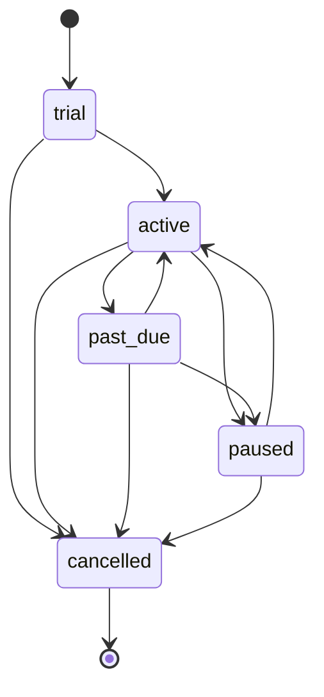

# BillFlow AI Architecture

## System purpose

BillFlow AI contains two tenant-isolated but complementary product areas:

1. **Personal Finance OS** — user bills, linked-provider obligations, balances, SafePay recommendations, and human-authorized settlement.
2. **Billing Operations** — a SaaS operator control plane for plans, customers, recurring subscriptions, invoices, mock gateway events, retries, refunds, regional tax, PDFs, notifications, audit, and revenue analytics.

The second area implements the complete recurring-payment specification without pretending the sandbox is a licensed payment rail.

## Runtime topology

Docker Compose runs PostgreSQL, Redis, the API, a worker, Beat, and the Nginx-hosted frontend. Alembic applies the schema before the API becomes healthy; workers wait for that health check to avoid concurrent migration races.

## Billing renewal data flow

Every cycle has a unique `cycle:<subscription>:<period-start>` idempotency key. Invoice numbers use a tenant/month counter (`BF-YYYYMM-NNNNNN`). Usage records also carry tenant-scoped idempotency keys and are attached to one invoice only.

## Subscription state machine

State changes are validated centrally and timestamped (`trial_started_at`, `activated_at`, `past_due_at`, `paused_at`, `cancelled_at`, and `status_changed_at`). End-of-cycle changes are represented as pending state (`pending_plan_id` or `cancel_at_period_end`) and applied by the renewal engine.

## Payment and recovery flow

- The mock gateway creates the same canonical payload used by the public webhook endpoint.
- HMAC-SHA256 signs the canonical JSON body; the handler uses constant-time comparison.
- Gateway event ID and payment idempotency key prevent double processing.
- The first failure changes an active subscription to `past_due` and queues attempts for days 1, 3, and 7.
- A successful retry restores `active` and cancels later queued attempts.
- Exhausting the third retry cancels the subscription and creates a durable notification event.
- Refunds cannot exceed the paid, unrefunded balance. They add a negative invoice line and invalidate the stored PDF so the next download reflects the refund.

## Security and tenancy

- JWT sessions are accepted through an HTTP-only cookie or Bearer token.
- Every Billing Operations query and mutation is scoped to `owner_user_id`.
- Cross-tenant resource IDs return `404`, avoiding resource enumeration.
- Webhooks do not require a browser JWT; they require the shared HMAC secret and include an owner identifier inside the signed payload.
- Payment, refund, lifecycle, invoice, plan, usage, and demo events write customer-aware audit records.
- BillFlow does not collect card data, UPI PINs, OTPs, bank passwords, or biometric material.

## Persistence decisions

PostgreSQL is the deployment database. SQLite remains supported for local development and deterministic tests. PDFs are persisted as bytes with SHA-256 and generation time, satisfying the specification while keeping the storage boundary replaceable with S3-compatible object storage later.

## Observability boundaries

The health endpoint reports process readiness. Audit logs explain business state changes; notification outbox rows expose delivery state; Celery and container logs expose worker failures. Production should additionally add metrics, tracing, alerting, centralized logs, and dead-letter monitoring.
