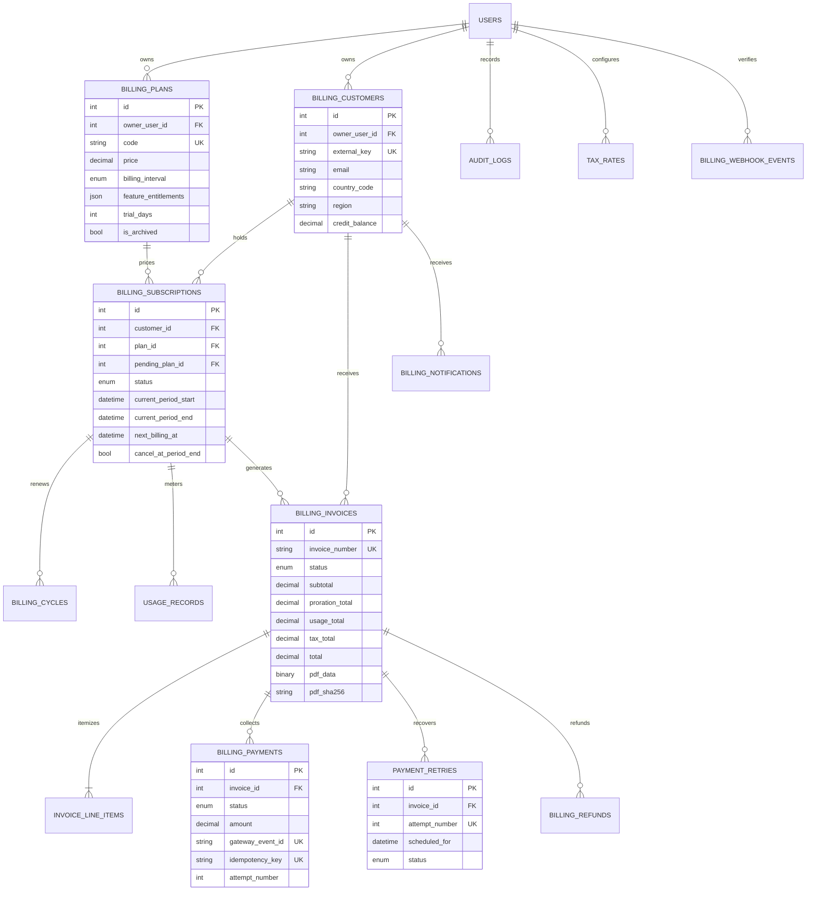

# Database ERD

The diagram focuses on the recurring billing domain. Every tenant-owned root has `owner_user_id`; ownership is also retained on high-volume operational tables so queries can enforce tenancy directly.

The Alembic initial migration contains the complete personal-finance and billing schema, indexes, foreign keys, unique constraints, and named enum types. Apply it with `alembic upgrade head`.
