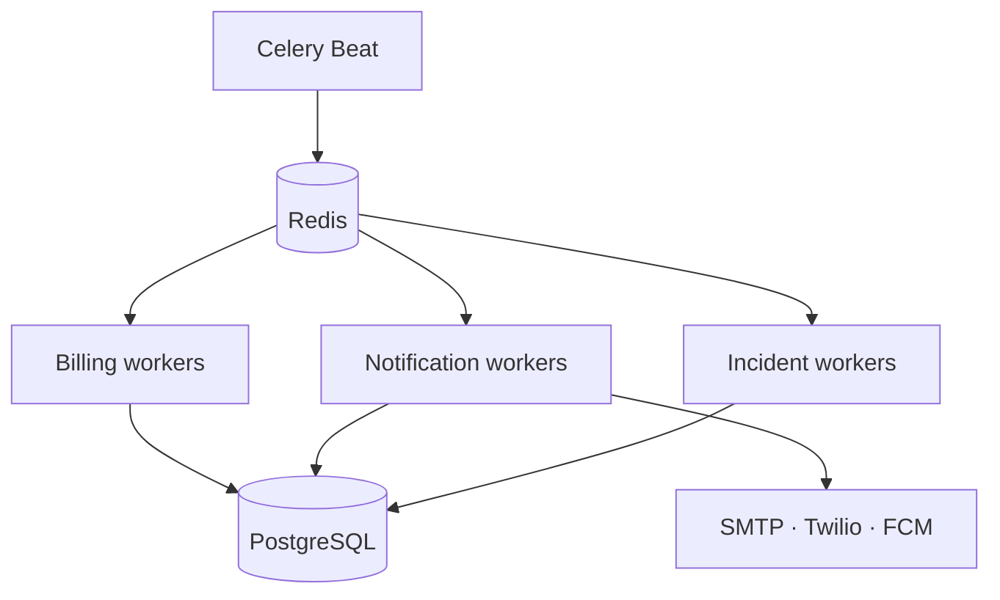
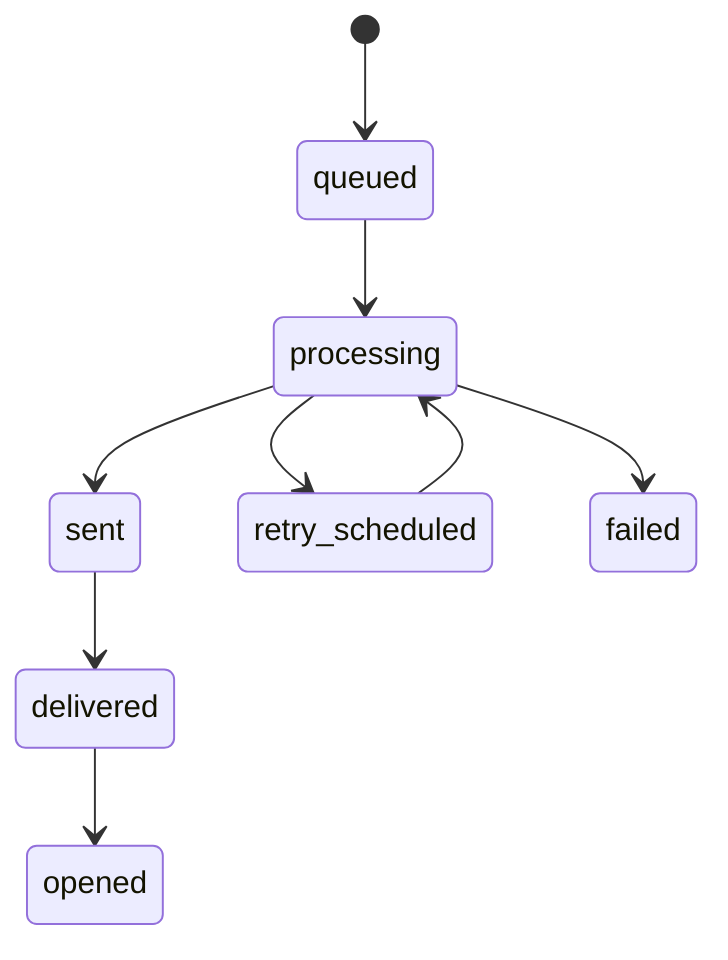

# Real-Time Payment Incident and Notification Engine

## What is implemented

The engine is an application-level reliability layer around payment processing. It does not authorize or settle money; it detects and communicates state around a configured gateway.

| Capability | Implementation |
|---|---|
| Transactional outbox | A notification row and its realtime event are written inside the originating billing transaction. |
| Concurrent delivery | PostgreSQL workers lease due rows with `FOR UPDATE SKIP LOCKED`; an expiring lease makes crashed work reclaimable. |
| Delivery retries | Per-message attempt count, maximum attempts, next-attempt time and capped exponential backoff. |
| Task retries and DLQ | Celery automatically retries failed tasks five times with jittered backoff; terminal envelopes are persisted in `task_dead_letters`. |
| Email | Authenticated SMTP with optional STARTTLS. |
| SMS | Twilio Messages REST API. |
| Push | Firebase Cloud Messaging HTTP v1 with a service account. |
| Receipts | Idempotent, HMAC-signed provider callbacks update sent, delivered, opened or failed state without regressing terminal success. |
| Payment watchdog | Pending payments older than the configured timeout open critical incidents and are scheduled for provider inquiry. |
| Reconciliation | Provider status polling records immutable checks and applies terminal results through the existing signed, idempotent event handler. |
| Escalation | Per-customer channels, event filters, quiet hours, retry limits and timed escalation rules. |
| Live dashboard | Authenticated SSE backed by a durable event table and resumable with `Last-Event-ID`. |
| Monitoring | Prometheus metrics, optional Sentry, queue age/depth checks and durable queue-health incidents. |

## Worker topology



The provided Docker worker consumes every routed queue. At higher volume, run separate workers with `-Q billing.notifications`, `-Q billing.incidents`, `-Q billing.reconciliation`, and `-Q billing.default` so provider latency cannot starve billing cycles.

## Delivery state model



`status` remains the backward-compatible queued/sent/failed summary. `delivery_status` is the authoritative fine-grained state. A worker commits `processing`, attempt count and lease before network I/O. Success stores the provider message ID. Failure either schedules the next attempt or marks the message failed/dead-lettered and opens a payment incident.

## Provider configuration

Sandbox delivery is the safe default for every channel. Enable a real adapter only when its complete credentials are present.

### SMTP email

```dotenv
EMAIL_PROVIDER=smtp
SMTP_HOST=smtp.example.com
SMTP_PORT=587
SMTP_USERNAME=...
SMTP_PASSWORD=...
SMTP_FROM_EMAIL=billing@example.com
SMTP_STARTTLS=true
```

### Twilio SMS

```dotenv
SMS_PROVIDER=twilio
TWILIO_ACCOUNT_SID=...
TWILIO_AUTH_TOKEN=...
TWILIO_FROM_NUMBER=+15551234567
```

### Firebase push

```dotenv
PUSH_PROVIDER=fcm
FCM_PROJECT_ID=project-id
FCM_SERVICE_ACCOUNT_JSON=/run/secrets/fcm-service-account.json
```

`FCM_SERVICE_ACCOUNT_JSON` accepts either an injected JSON document or a mounted file path. Production should use a secret mount or workload identity and restrict the service account to Firebase messaging.

## Payment polling

For a non-sandbox gateway, configure `GATEWAY_STATUS_BASE_URL` and, when required, `GATEWAY_STATUS_TOKEN`. The adapter performs `GET {base_url}/{gateway_reference}` and expects a JSON `status`. It normalizes `paid`, `succeeded`, `captured`, and `settled` to success; `failed`, `declined`, `cancelled`, and `expired` to failure; everything else remains pending.

The generic adapter is intentionally narrow. A production gateway with request signing, nonstandard identifiers or a different response format should receive a dedicated adapter and contract tests.

## Signed delivery receipts

Providers or an ingress translation function POST to:

```text
POST /api/v1/billing/webhooks/notification-receipts/{provider}
X-BillFlow-Signature: <hex HMAC-SHA256>
```

The JSON body contains `event_id`, `provider_message_id`, `status`, `occurred_at`, and optional `metadata`. Sign canonical JSON with `NOTIFICATION_RECEIPT_WEBHOOK_SECRET`. Use a secret separate from the payment webhook secret and rotate both through a managed secret store.

## Schedules and thresholds

| Job | Default cadence |
|---|---:|
| Deliver notification outbox | 30 seconds |
| Pending-payment watchdog | 60 seconds |
| Gateway status polling | 60 seconds |
| Incident escalation | 60 seconds |
| Queue-health evaluation | 60 seconds |
| Due billing cycles | 5 minutes |
| Due payment retries | 5 minutes |

Tune `PENDING_PAYMENT_TIMEOUT_SECONDS`, `NOTIFICATION_*`, `QUEUE_BACKLOG_ALERT_THRESHOLD`, and `QUEUE_OLDEST_ALERT_SECONDS` for the gateway and service-level objectives. Queue alerts become incidents; Prometheus should also alert independently so a broken application delivery path cannot hide its own failure.

## Production checklist

- Run PostgreSQL, Redis, API, Beat and workers as separately scalable services; ensure only one Beat scheduler is active.
- Give every vendor a verified sender/domain and production account. Sandbox mode proves control flow, not deliverability.
- Put `/metrics` on an internal ingress and configure Prometheus/Alertmanager. Set `SENTRY_DSN` only after privacy and sampling review.
- Store webhook, SMTP, Twilio and FCM credentials in a managed secret service; never commit them or expose them to the frontend.
- Configure dead-letter and incident ownership, on-call routing, retention, replay policy and operational runbooks.
- Load-test with production-like PostgreSQL/Redis/network latency and vendor rate limits before setting SLOs.
- Add provider-specific suppression, unsubscribe and regional messaging compliance before customer-facing use.
